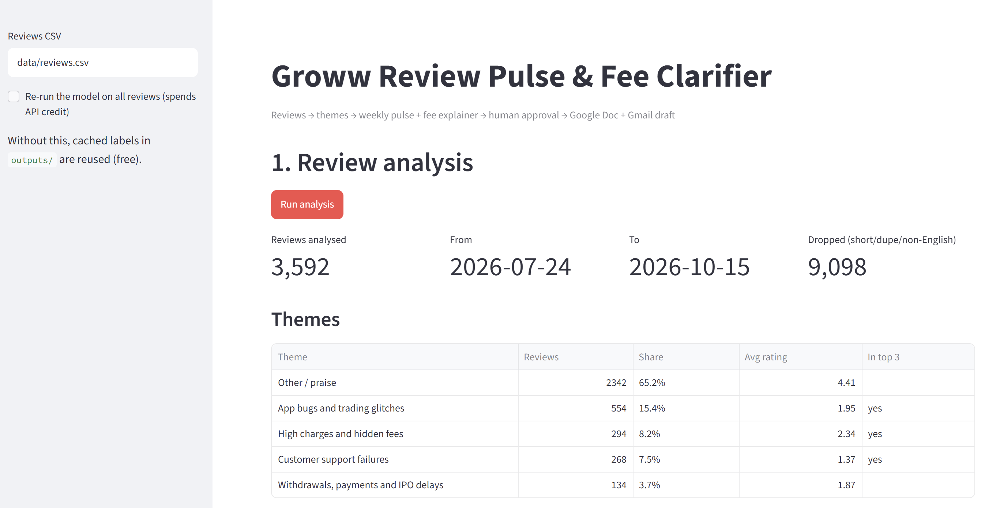
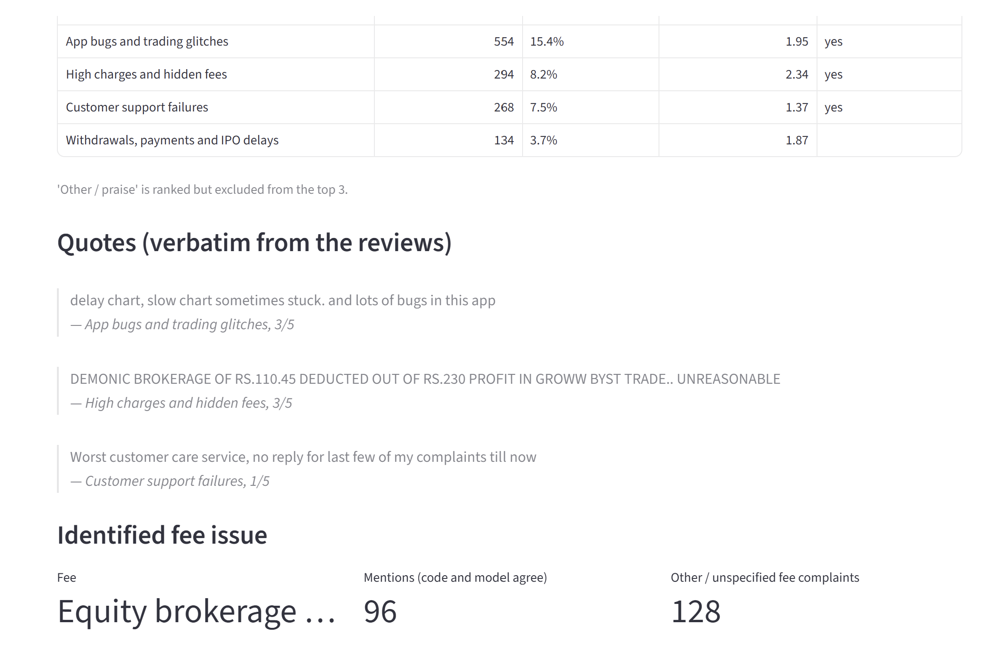
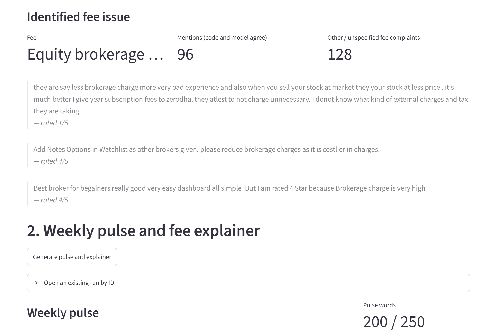
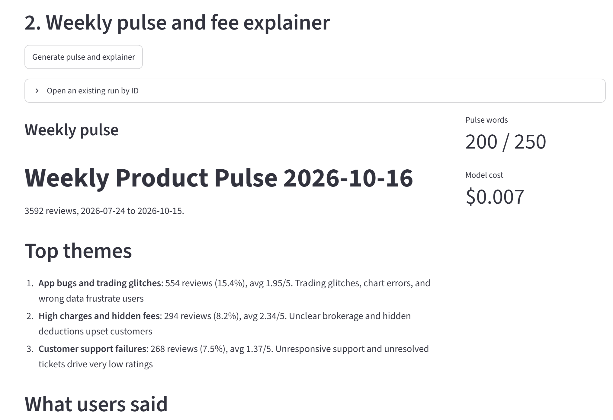
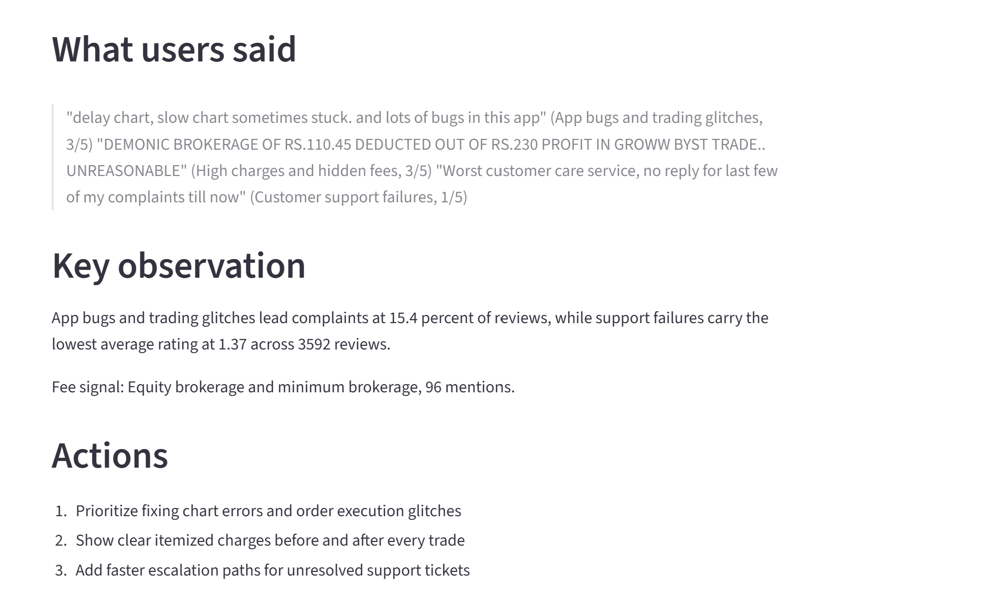
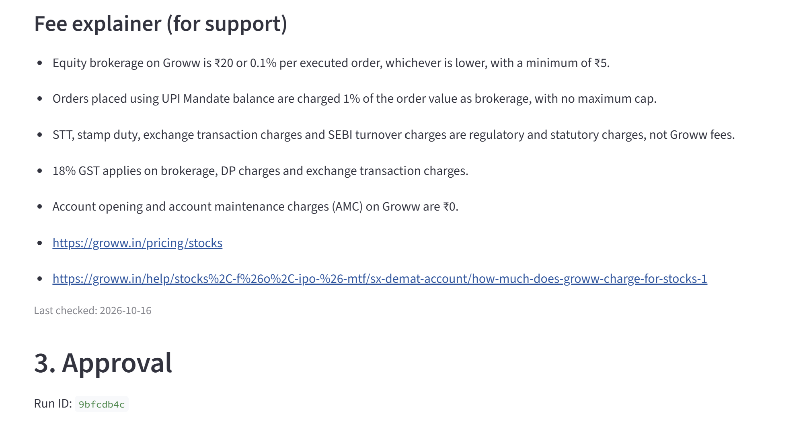
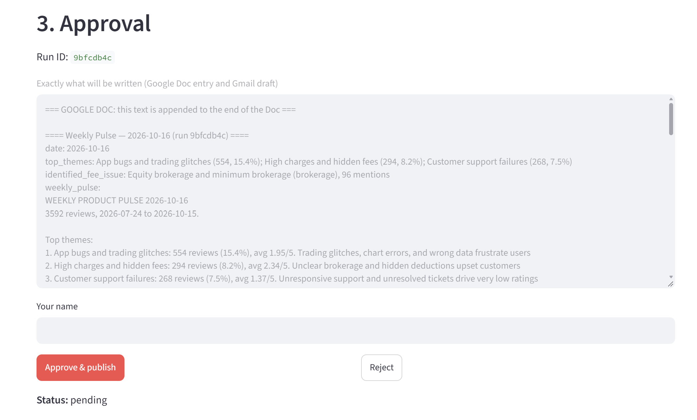
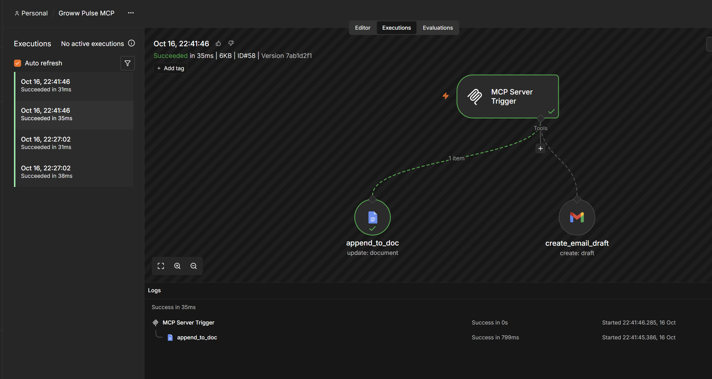
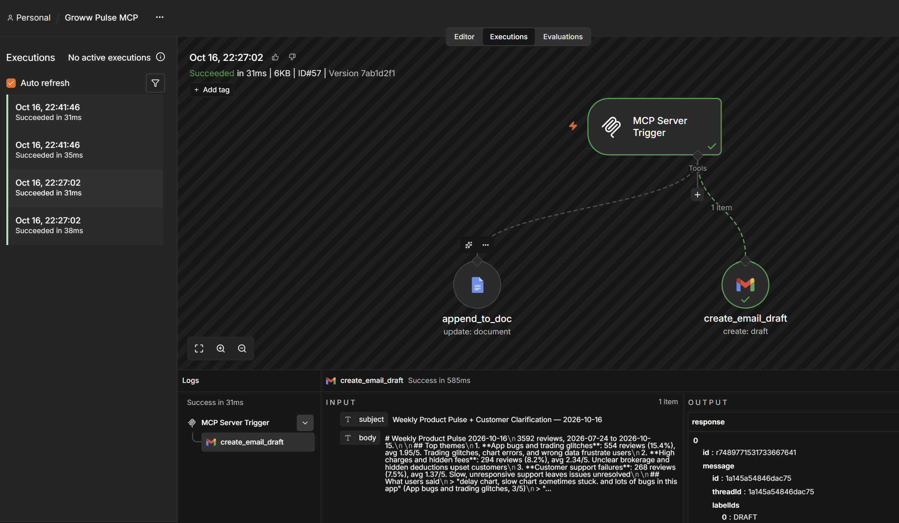
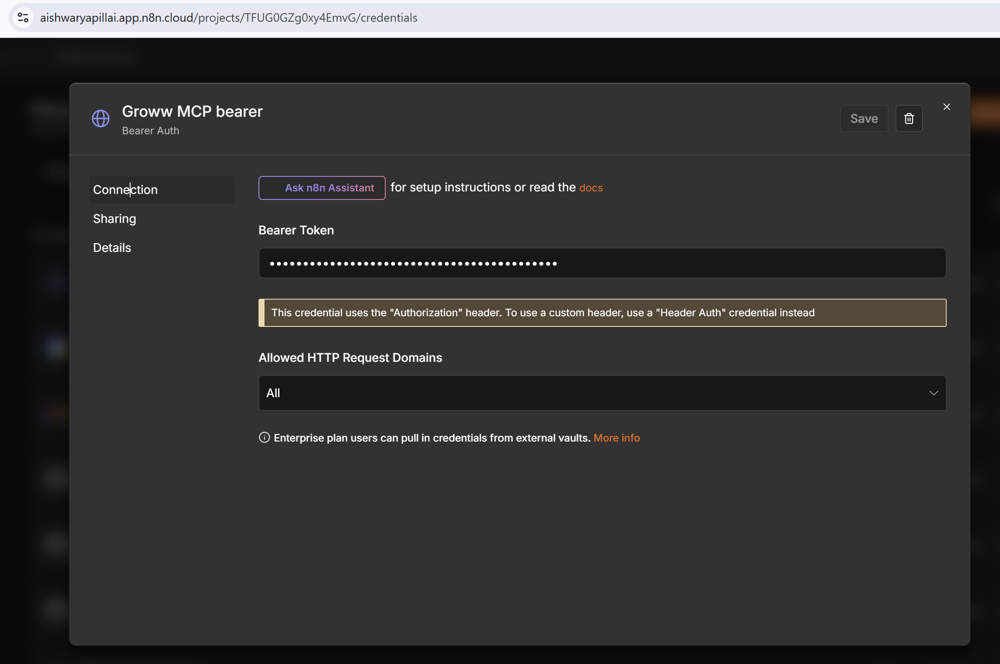

# Groww Review Pulse & Fee Clarifier

An AI workflow that turns public Groww Play Store reviews into (1) an internal **weekly product pulse** and (2) a facts-only **fee explainer** for support. After a human approves the exact content, it appends both to a Google Doc and creates a Gmail **draft** (never sent) through an n8n MCP server.

## Live demo
**App:** https://groww-review-pulse-assistant.onrender.com/

- **Password protected.** The password is shared with reviewers separately (not in this repo). Without it, anyone with the link could click *Approve & publish* (writes to the Google Doc and Gmail) or *Generate* (spends Anthropic API credit).
- **First load can take 30–60 seconds.** The app runs on Render's free plan, which sleeps when idle.
- **No password?** The [screenshots](#screenshots) below show the full run end to end.

## Result of the submitted run
Analysed **3,592 reviews** (24 Jul – 15 Oct 2026, 12 weeks) after dropping short, duplicate and non-English rows.

- **Top 3 problem themes:** App bugs and trading glitches (554), High charges and hidden fees (294), Customer support failures (268).
- **Identified fee issue: equity brokerage** (96 reviews where keywords and the model agree). DP charges (5) and exit load (1) barely appear in this window. The PRD's guess of DP charges was not borne out; the fee came from the data.
- Separately, 128 reviews complain about charges in general terms ("charges are very high"). They map to no registry entry, so they are shown in the app and CLI output but have no explainer and are not yet mentioned in the pulse text.

## Screenshots
All images are in [`screenshots/`](screenshots/). Click any image to open it full size.

### 1. Review analysis
| | |
|---|---|
| **Run analysis.** 3,592 reviews in the 12-week window and the five themes with counts, share and average rating. |  |
| **Top 3 and quotes.** "Other / praise" is excluded from the top 3. Three verbatim quotes, one per top theme, and the identified fee issue. |  |
| **Fee issue evidence.** Example reviews behind the brokerage signal (96 mentions where code and model agree; 128 general charge complaints). |  |

### 2. Weekly pulse and fee explainer
| | |
|---|---|
| **Weekly pulse: top themes.** Word count (200 / 250) and model cost shown alongside. |  |
| **Weekly pulse: quotes, key observation and 3 actions.** |  |
| **Fee explainer for support.** Facts from the verified registry, two official Groww links added by code, and the "Last checked" date. |  |

### 3. Approval gate
| | |
|---|---|
| **Approval.** A read-only preview of exactly what will be written to the Doc and the Gmail draft. Nothing is written until **Approve & publish**; **Reject** writes nothing. Status starts as `pending`. |  |

### 4. MCP actions in n8n (after approval)
| | |
|---|---|
| **`append_to_doc` succeeded.** The MCP Server Trigger called the Google Docs tool. |  |
| **`create_email_draft` succeeded.** The Gmail tool created a draft; the output shows the label `DRAFT`, so nothing was sent. |  |
| **Bearer auth on the MCP server.** Only clients with the token can call the tools (token hidden). |  |

<!-- TODO: add these before submitting (required by the brief):
| **Google Doc entry.** The appended entry with its run ID. |  |
| **Gmail draft.** The draft open in the Drafts folder. |  |
-->

## How it works
```
reviews.csv ─► ingest ─► themes (Claude) ─► assign every review (Claude, batched)
            ─► rank + quotes (code) ─► fee detection (keywords + Claude)
            ─► pulse + explainer (Claude writes prose, code renders and validates)
            ─► APPROVAL GATE (app or CLI) ─► MCP client ─► n8n ─► Google Doc + Gmail draft
```
**Model vs code.** Claude does judgement work (theme names, labelling, wording). Code does everything that must be exact: counts, quotes (verbatim substring check), links (from the registry), the 250-word limit, number checks, and the approval guard.

## Setup
Python 3.14, Windows PowerShell shown (adapt paths on other systems).
```
python -m venv .venv
.venv\Scripts\python -m pip install -r requirements.txt
copy .env.example .env      # then fill in ANTHROPIC_API_KEY, N8N_MCP_URL, N8N_MCP_TOKEN
```
Dependencies are pinned. `.env` is git-ignored.

## Run
1. **Get reviews** (your machine; needs internet access to Google Play):
   `.venv\Scripts\python scripts\scrape_reviews.py --weeks 12 --max-reviews 20000 --out data\reviews.csv`
   A 50-row sample of the real scrape is in `data/reviews_sample.csv`.
2. **App (recommended):** `.venv\Scripts\streamlit run app.py`
   Click *Run analysis*, then *Generate pulse and explainer*, review, then approve or reject.
3. **Or CLI:** `.venv\Scripts\python run_pipeline.py` (prints the run ID), then `.venv\Scripts\python publish.py <run_id>`.

Labels from the model are cached in `outputs/`, so re-running costs almost nothing. Use the app's *Re-run the model* box (or `run_pipeline.py --refresh`) to re-label. A full re-label of ~3,600 reviews is estimated at $1–3 of API credit (check your own usage).

## Where approval happens
- **In the app:** section 3 shows exactly what will be written (the Doc entry and the Gmail draft). Enter your name, then **Approve & publish** or **Reject**.
- **In the CLI:** `publish.py <run_id>` prints the same preview; type `APPROVE` or `REJECT`.
- **Rules enforced in code:** nothing is written before approval. Reject writes nothing and records the decision. The approval hash covers the payload and the email subject and body, so any edit after approval blocks publishing. Re-publishing the same run ID does nothing, and a partial failure resumes without duplicating the Doc entry. There is no send tool anywhere.
- Each run has an audit record, `outputs/approval_<run_id>.json` (decision, approver, time, tool results incl. Doc ID and draft ID).

## n8n (the only thing that can write to Google)
Follow `n8n/SETUP.md`. The workflow has an MCP Server Trigger and two tools: `append_to_doc` (Google Docs) and `create_email_draft` (Gmail draft). `python publish.py --list-tools` verifies the connection without writing anything. n8n Cloud's production URL ends in `/sse`; the client detects this and uses the SSE transport.

## Tests
`.venv\Scripts\python -m pytest -q` runs offline (stub model, stub MCP session, headless app tests). No API calls are made.

## Layout
```
app.py, run_pipeline.py, publish.py     app, pipeline, CLI approval
pulse/   ingest, llm, themes, quotes, fees, generate, validate, render, approval, mcp_publish
config/fee_registry.json                 human-verified fee facts and official links
scripts/scrape_reviews.py                Play Store scraper
n8n/                                     workflow template and setup guide
data/reviews_sample.csv                  first 50 rows of the real scrape
tests/                                   offline tests (synthetic data only)
PRD.md, implementation.md, BACKLOG.md    requirements, plan, shelved enhancements
```

## Known limitations
- The Doc entry and email are **plain text** (markdown is converted). Rich HTML formatting is backlog item C5.
- The fee explainer covers only fees in the registry; generic "charges are high" complaints have no explainer.
- A new run ID for the same week appends a second Doc entry and a second draft (backlog C6).
- English-language Play Store reviews only; fee facts must be re-verified before each run (`last_checked`).
